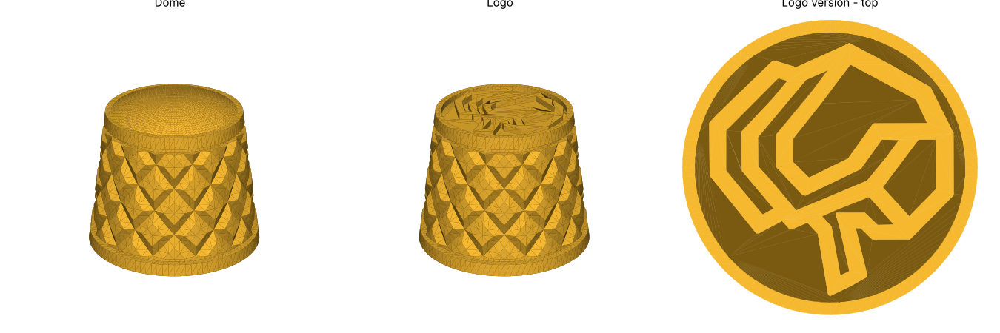
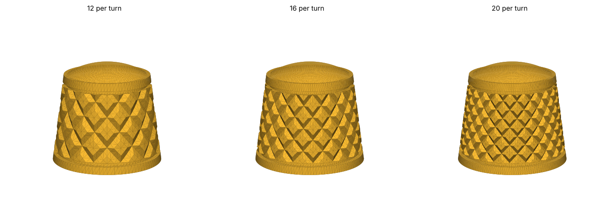
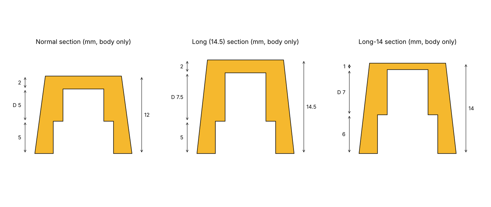

# ogm10-Jupiter

RP2040 と USB ハブ（CH334F）を基板に載せた、43キー + ロータリーエンコーダー 2個の一体型キーボード

## Specs

| 項目 | 内容 |
|---|---|
| キー数 | 43キー + ロータリーエンコーダー 2個（左右・プッシュスイッチ付き） |
| スイッチ | Kailh Choc V2（ホットスワップソケット） |
| MCU | RP2040（基板直付け） |
| フラッシュ | W25Q128JVSIQ（128Mbit / 16MB） |
| USB | Type-C 入力 ×1 + USB ハブ出力（Type-C）×3 |
| マトリクス | 4行 × 12列（COL2ROW、エンコーダーのプッシュもマトリクス内） |
| 基板サイズ | 約 229.2 mm × 76.2 mm |
| 取り付け穴 | φ2.2 mm × 8（M2） |
| ファームウェア | QMK / Vial |

### USB ハブ

- 上流の USB-C IN から CH334F（4ポートハブ）に入り、ポート1〜3 を USB-C OUT1〜3、ポート4 を RP2040 に接続しています。
- 入力は ESD 保護（USBLC6-2SC6）と 2A ポリスイッチを通り、出力側の 5V ラインには 22µF ×4 のバルクコンデンサ、各出力ポートの CC には 56kΩ プルアップ（Rp）が付いています。
- 5V 系の配線は周囲とのクリアランスが取れる範囲で最大 1mm まで太くしています（狭い箇所は 0.3〜0.5mm）。
- 出力ポートの合計電流は、上流のポートが供給できる範囲（一般的なPCのポートなら 500mA〜900mA 程度）に収まるように使ってください。
- CH334F の PSELF ピンは未接続（R4 なし）で、ハブはセルフパワーとして申告します。プルダウン（R4）を付けるとバスパワー申告になり、RP2040 のブートローダーなど 100mA を超える電流を申告するデバイスがホストに拒否されます。

## Parts List

### 自分で用意するもの

| Part | Quantity |
|---|---|
| Choc V2 スイッチ | 43 |
| キーキャップ（Choc 用） | 43 |
| ロータリーエンコーダー用ノブ | 2（3Dプリント用データあり → [knob/](knob)） |
| USB Type-C ケーブル | 1〜 |
| M2×6mm ネジ（トッププレート側） | 8 |
| M2×4mm ネジ（ボトムプレート側） | 8 |
| M2×3mm スペーサー | 8（例: [Amazon](https://amzn.asia/d/0fCThe3z)） |
| M2 ワッシャー（厚さ 1mm） | 8（3Dプリント: `M2_washer_t1.0_D5.3mf`） |

### 基板実装部品（PCB裏面）（JLCPCB の PCBA で実装）

| Ref | Part | Package | LCSC | Qty |
|---|---|---|---|---|
| U2 | RP2040 | LQFN-56 | C2040 | 1 |
| U3 | W25Q128JVSIQ（QSPI Flash） | SOIC-8 | C97521 | 1 |
| U1 | CH334F（USB 2.0 ハブ） | QFN-24 | C5187527 | 1 |
| U4 | XC6206P332MR（3.3V LDO） | SOT-23 | C5446 | 1 |
| X2 | 12MHz 水晶 ABM8-272-T3（RP2040 用） | 3225 | C20625731 | 1 |
| X1 | 12MHz 水晶 X322512MSB4SI（ハブ用） | 3225 | C9002 | 1 |
| D1 | USBLC6-2SC6（ESD 保護） | SOT-23-6 | C7519 | 1 |
| F1 | 2A PTC ヒューズ SMD1206P200TF | 1206 | C20988 | 1 |
| USBC1–4 | TYPE-C-31-M-12 | SMD | C165948 | 4 |
| JP1 | 2P ピンヘッダ（BOOT 用） | 2.54mm | C492401 | 1 |
| D2–D46 | 1N4148W | SOD-123F | C81598 | 45 |
| R1, R2 | 5.1kΩ（上流 CC プルダウン） | 0603 | C23186 | 2 |
| R5–R10 | 56kΩ（下流 CC プルアップ） | 0603 | C23206 | 6 |
| R12, R13 | 27Ω（USB D+/D-） | 0603 | C25190 | 2 |
| R11, R15 | 1kΩ（XOUT 直列 / BOOT） | 0402 | C11702 | 2 |
| R14 | 10kΩ（RUN プルアップ） | 0402 | C25744 | 1 |
| C1, C25, C26 | 10µF | 0805 | C15850 | 3 |
| C5–C8 | 22µF | 0805 | C45783 | 4 |
| C21, C22, C27 | 1µF（C27 = CH334F V5 用） | 0603 | C15849 | 3 |
| C3 | 10µF（CH334F VDD33 用） | 0603 | C96446 | 1 |
| C2, C4, C9 | 100nF | 0603 | C14663 | 3 |
| C10, C13–C20, C23, C24 | 100nF | 0402 | C1525 | 11 |
| C11, C12 | 15pF | 0402 | C1548 | 2 |

### 基板実装部品（PCB表面）（手はんだで実装）

JLCPCB の PCBA では実装しないので、基板が届いてから手はんだします。

| Ref | Part | Package | LCSC | Qty |
|---|---|---|---|---|
| ENC1, ENC2 | ロータリーエンコーダー EC11 / EC12（どちらも使用可、プッシュスイッチ付き）<br>例: ALPS EC11E18244A5（18パルス / 36クリック） | THT | C255515（EC11E18244A5） | 2 |
| SW3–SW45 | Choc ホットスワップソケット CPG135001S30 | SMD | C5333465 | 43 |

## ロータリーエンコーダー用ノブについて

ENC1 / ENC2（EC11 / EC12、φ6 Dカット軸）用のノブを3Dプリントで作れます。データは [knob/](knob) にあります。

市販品であればuxcell ポテンショメータノブ　ASINコード「B07TJQB7FB」がおすすめです。



天面の形（2種）× 軸の長さ（3種）× 側面の網目（2種）の組み合わせで STL を用意しています。下の「選び方」で自分に合うファイルを選んでください。

### 選び方

#### 1. 天面の形

| 種類 | 内容 |
|---|---|
| ドーム版（`dome`） | 天面が球面にふくらむ |
| ロゴ版（`logo`） | 天面のくぼみにイラストを浮き出し |

#### 2. 軸の長さ（エンコーダーに合わせる）

EC11 / EC12 には、軸のDカット部分（平らに削られた部分）の長さが違う製品があります。手持ちのエンコーダーのDカット部分を測って選んでください。

| Dカット部分の長さ | 使うノブ | 断面（下から 底の穴 / Dカット穴 / 天井） | 胴体の高さ |
|---|---|---|---|
| 約5 mm | 通常版（ファイル名に `long` なし） | 5 / 5 / 2 mm | 12 mm |
| 約7.5 mm（通常より2.5 mm長い） | ロング（`long`） | 5 / 7.5 / 2 mm | 14.5 mm |
| 約7 mm | ロング14（`long14`） | 6 / 7 / 1 mm | 14 mm |

#### 3. 側面の網目（ノズル径に合わせる）

| ノズル径 | 網目 | ファイル名 |
|---|---|---|
| 0.4 mm | 一周12山（網目の横幅 底で約3.9 mm） | 末尾に `fine` なし |
| 0.2 mm | 一周20山（網目の横幅 底で約2.4 mm） | 末尾が `-fine` |



### ファイル一覧

| | 0.4 mm ノズル（12山） | 0.2 mm ノズル（20山） |
|---|---|---|
| ドーム版・通常 | `ogm10-Jupiter-knob-dome.stl` | `ogm10-Jupiter-knob-dome-fine.stl` |
| ロゴ版・通常 | `ogm10-Jupiter-knob-logo.stl` | `ogm10-Jupiter-knob-logo-fine.stl` |
| ドーム版・ロング | `ogm10-Jupiter-knob-dome-long.stl` | `ogm10-Jupiter-knob-dome-long-fine.stl` |
| ロゴ版・ロング | `ogm10-Jupiter-knob-logo-long.stl` | `ogm10-Jupiter-knob-logo-long-fine.stl` |
| ドーム版・ロング14 | `ogm10-Jupiter-knob-dome-long14.stl` | `ogm10-Jupiter-knob-dome-long14-fine.stl` |
| ロゴ版・ロング14 | `ogm10-Jupiter-knob-logo-long14.stl` | `ogm10-Jupiter-knob-logo-long14-fine.stl` |

ほかに、`ogm10-Jupiter-knob-fit-test.stl`（はめあい確認用リング 3種、全バージョン共通）と、寸法を変えて作り直すための FreeCAD マクロ（`*.FCMacro`）があります。マクロは12山の設定になっているので、20山にする場合は `KNURL_COUNT` を `20` に変えて実行してください。

### 主な寸法

| 項目 | 寸法 |
|---|---|
| 外径 | 底 φ15 mm → 上端 φ11.75 mm（テーパー、全バージョン共通） |
| 全高 | 通常版: ドーム版 約13.5 mm / ロゴ版 12 mm<br>ロング: ドーム版 約16 mm / ロゴ版 14.5 mm<br>ロング14: ドーム版 約15.5 mm / ロゴ版 14 mm |
| 側面 | 先端を平らにカットしたアヤメローレット（一周12山 または 20山、溝深さ0.4 mm）、上下に1 mmの平らな帯と切れ込み |
| 軸穴 | φ6 Dカット（D幅4.5 mm）、片側すき間0.15 mm + 圧入リブ3本（高さ0.25 mm）、深さは上の表のとおり |
| 底の穴 | φ9.3 mm（エンコーダー本体の逃げ）、深さは上の表のとおり |

### 断面図



断面図の見方（下から順に）:

- **底の穴（5 / 5 / 6 mm）**: エンコーダー本体の上部が入る逃げ穴です。
- **Dカット穴（D 5 / D 7.5 / D 7 mm）**: 軸のDカット部分が入る穴です。エンコーダーのDカット部分の長さに合わせて深さを変えています。
- **天井（2 / 2 / 1 mm）**: 穴の上に残す厚みです。
- **全高（12 / 14.5 / 14 mm）**: 胴体の高さです。ドーム版はこの上にドームが乗ります。

天面の直径（φ11.75 mm）はどのバージョンも同じなので、ロゴの大きさと線幅は変わりません。胴体が高いバージョンほど側面の傾斜は少しゆるやかになります（通常版 約7.7° / ロング14 約6.6° / ロング 約6.4°）。軸穴の形は共通なので、はめあい確認用リングはどのバージョンにも使えます。

### 印刷のコツ

- 天面を上にして（底の穴を下にして）そのまま印刷できます。
- 軸穴のきつさはプリンターごとに差が出るので、先に `ogm10-Jupiter-knob-fit-test.stl` を印刷して確認するのがおすすめです。高さ 4 / 5 / 6 mm のリングがリブ高さ 0.15 / 0.25 / 0.35 mm に対応し、STL のノブは 5 mm のリングと同じ（0.25 mm）です。
- ゆるい・きつい場合は、マクロの `RIB_HEIGHT` を合ったリングの値に変えて FreeCAD で実行し、メッシュを STL に書き出してください。
- ロゴ版のイラストの線幅は約0.6 mm です。0.4 mm ノズルでも印刷できますが、0.2 mm ノズルのほうが線がくっきり出ます。
- 0.2 mm ノズルなら、20山の細かい網目もきれいに出ます。網目が浅く感じる場合は、マクロの `KNURL_DEPTH` を 0.4 → 0.5 mm にすると溝がはっきりします。
- ロング14のロゴ版は、天井1 mmに天面のくぼみ0.5 mmがあるため、軸穴の真上の厚みが0.5 mmしかありません。軸は強く押し込みすぎないようにしてください。

## PCBA（JLCPCB）発注時の部品向きの注意

EasyEDA から出力した CPL（部品座標ファイル）のままだと、JLCPCB 側で一部の部品の向きがずれます。発注時に JLC の部品配置ビューアーで必ず確認・修正してください。

### ビューアーの見方

- 部品はボトム面に実装するため、JLC のビューアーではボトム面が**左右反転**して表示されます（EasyEDA の画面と左右が逆になります）。
- マゼンタの点が **1番ピン**、ダイオードの「−」が**カソード**です。
- 基板のシルク（黒い点やダイオード記号）と重ねて照合すると分かりやすいです。

### 修正が必要だった部品

| Ref | 部品 | 修正 | 正しい状態（JLC ビューアー上） |
|---|---|---|---|
| USBC1–USBC4 | TYPE-C-31-M-12 | 向きが逆 → 反転 | マゼンタの点（ピン）が基板の内側、差し込み口が基板の外側を向く |
| U1 | CH334F | 180° 回転 | 1番ピンの点が左下 |
| U2 | RP2040 | 回転 | 1番ピンの点が右下（シルクの黒点と一致） |
| U3 | W25Q128 | 回転 | 1番ピンの点が右下のピン（シルクの点と一致） |
| U4 | XC6206 | 180° 回転 | 2ピン側が右、1番ピン（GND）が右下。EasyEDA 上では GND パッドが左下・+3V3 が左上 |
| D13 | 1N4148W | 180° 回転 | 「−」が左。EasyEDA 上では右側のパッド（ROW0 側）がカソード |

### 修正不要だった部品（確認済み）

| Ref | 確認内容 |
|---|---|
| D1（USBLC6） | 1番ピンの点が左下でシルクと一致 |
| D2 | 「−」が左（EasyEDA 上で右側パッド＝ROW0 側がカソード） |
| D3–D46（縦向き） | 「+」が上、「−」が下 |
| X1, X2（水晶） | 180° ずれても電気的に問題なし（90° ずれは NG） |
| 抵抗・コンデンサ | 極性なし |

### チェックリスト

- [ ] JLC の「部品配置の確認（Confirm Parts Placement）」オプションを付ける（エンジニアが製造前に向きを確認してくれます）。
- [ ] 上の表の部品を一つずつ、EasyEDA の PCB 画面と見比べて確認する（左右反転に注意）。
- [ ] 注文後 4〜6 時間ほどで Order History の DFM Analysis を確認する。
- [ ] Choc ホットスワップソケット（SW3–SW45）とロータリーエンコーダー（ENC1 / ENC2）は JLC では実装しないので、届いてから手はんだする（上の「手はんだで実装」の表）。
- [ ] 初回（2026年11月）の製造分は R4（ハブ PSELF の 10kΩ プルダウン）が実装されています。付いたままだとハブがバスパワー扱い（下流1ポートあたり 100mA）で申告され、Mac で「アクセサリに電力が必要です」と表示されて RP2040 が認識されません。R4 を取り外してください（現在のデータでは R4 は削除済みです）。

## 組み立て

取り付け穴 8か所を、上から順に次の構成で固定します。

```
↓ M2×6mm ネジ
トッププレート
ワッシャー（厚さ 1mm）
メイン基板（PCB）
M2×3mm スペーサー
ボトムプレート
↑ M2×4mm ネジ
```

1. ボトムプレートの下から M2×4mm ネジを通し、M2×3mm スペーサーを固定します。
2. スペーサーの上にメイン基板を載せます。
3. 基板の取り付け穴に厚さ 1mm のワッシャーを置き、その上にトッププレートを重ねます。
4. トッププレートの上から M2×6mm ネジを通し、スペーサーに固定します。

## Pin Assignment（RP2040）

| 機能 | GPIO |
|---|---|
| ROW0–ROW3 | GP6, GP7, GP8, GP9 |
| COL0–COL5 | GP0, GP1, GP2, GP3, GP4, GP5 |
| COL6–COL11 | GP18, GP19, GP20, GP21, GP22, GP23 |
| エンコーダー1（左） A / B | GP12 / GP13（プッシュ = マトリクス R0C0） |
| エンコーダー2（右） A / B | GP24 / GP25（プッシュ = マトリクス R0C11） |
| 未使用 | GP10, GP11, GP14–GP17, GP26–GP29 |
| USB D+ / D- | ハブ経由（CH334F ポート4） |

## 書き込み方法

1. 基板の BOOT ジャンパー（JP1）をショートしたまま USB-C IN にケーブルを接続します。
2. `RPI-RP2` ドライブとしてマウントされたら、ファームウェア（`.uf2`）をドラッグ＆ドロップします。

一度書き込んだ後は、左エンコーダーを押しながら接続（Bootmagic）するか、レイヤー3 の `QK_BOOT` でもブートローダーに入れます。

## Firmware

- QMK / Vial 用のファイルは [qmk_firmware/keyboards/ogm10_jupiter](qmk_firmware/keyboards/ogm10_jupiter) にあります。
- push するたびに GitHub Actions（`.github/workflows/build.yml`、`target.json`）で `ogm10_jupiter_vial.uf2` がビルドされ、Actions の Artifacts からダウンロードできます。
- デフォルトキーマップは仮のものです。Vial で自由に変更してください。Vial のアンロックは左右エンコーダーの同時押しです。
- `keyboard.json` / `vial.json` のキー位置は基板上のスイッチ座標をもとにしています。左端3段目と最下段中央の2キーが 1.5u、ほかは 1u です。Vial 上では左右のエンコーダーを 0.75u 幅で表示しています（左は左端、右は2〜4段目の右端に合わせています）。

## Files

| パス | 内容 |
|---|---|
| `pcb/ogm10-Jupiter-pcb.json` | メイン基板（EasyEDA Standard ソース） |
| `pcb/ogm10-Jupiter-schematic.json` | 回路図（EasyEDA Standard ソース） |
| `plate/ogm10-Jupiter-top-plate.json` | トッププレート（EasyEDA Standard ソース） |
| `plate/ogm10-Jupiter-bottom-plate.json` | ボトムプレート（EasyEDA Standard ソース） |
| `qmk_firmware/` | QMK / Vial ファームウェア |
| `knob/` | ロータリーエンコーダー用ノブ（STL / FreeCAD マクロ） |

EasyEDA Standard の「ファイル > 開く > EasyEDA ソース」で各 JSON を読み込めます。

## Build workflow

ファームウェアのビルドには [sekigon-gonnoc/vial-keymap-c-editor](https://github.com/sekigon-gonnoc/vial-keymap-c-editor) の再利用可能ワークフローを使っています。
