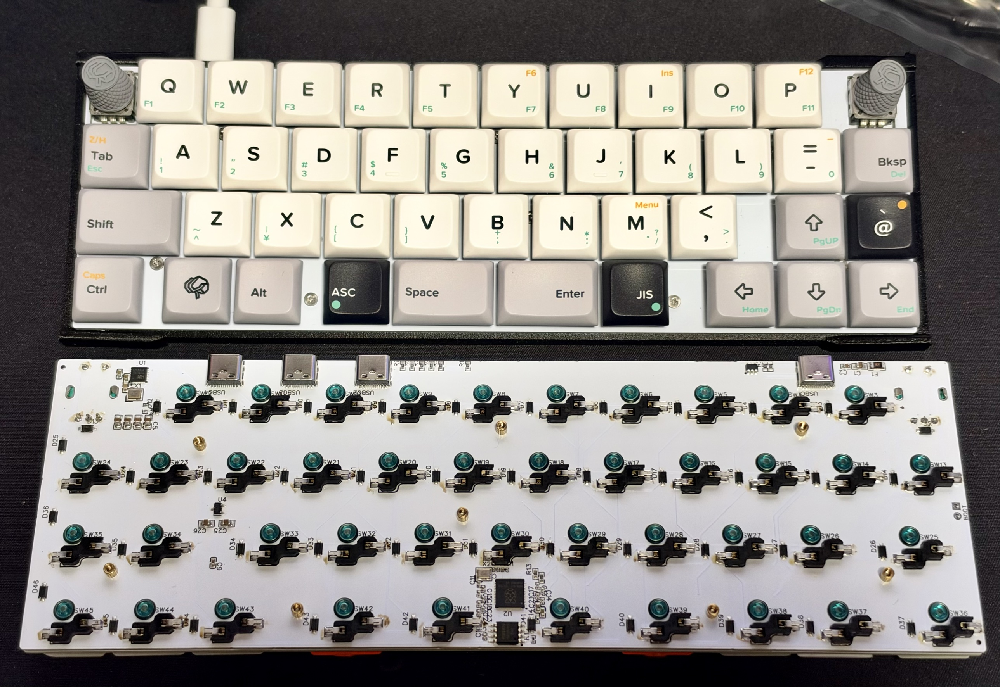

# ogm10-Jupiter

RP2040 と USB ハブ（CH334F）を基板に載せた、43キー + ロータリーエンコーダー 2個の一体型キーボード



## Specs

| 項目 | 内容 |
|---|---|
| キー数 | 43キー + ロータリーエンコーダー 2個（左右・プッシュスイッチ付き） |
| スイッチ | Kailh Choc V2（ホットスワップソケット） |
| MCU | RP2040（基板直付け） |
| フラッシュ | W25Q128JVSIQ（128Mbit / 16MB） |
| USB | Type-C 入力 ×1 + USB ハブ出力（Type-C）×3 |
| マトリクス | 4行 × 12列（COL2ROW、エンコーダーのプッシュもマトリクス内） |
| 基板サイズ | 約 229.2 mm × 76.2 mm |
| 取り付け穴 | φ2.2 mm × 8（M2） |
| ファームウェア | QMK / Vial |

## 設定ツール

Webブラウザ（PC版Chrome か Edge）で、マクロの編集、キー割り当ての変更、今のレイヤーのキー表示ができます。

ようはogm10-Jupiter用にVIALを改造したものです。

**https://oogamizin.github.io/KeyBord.ogm10-Jupiter/**

左ノブを押し込みしたまま、右下のキー（→）を押仕込みでもChromeで開くように仕込んでます。

使い方は [docs/README.md](docs/README.md) にあります。

## 詳細ドキュメント

| 内容 | ページ |
|---|---|
| 基板：USB ハブの仕様、実装部品の一覧、JLCPCB 発注時の注意、ピンアサイン | [pcb/README.md](pcb/README.md) |
| ファームウェア：書き込み方法、ビルド、Vial | [qmk_firmware/keyboards/ogm10_jupiter/readme.md](qmk_firmware/keyboards/ogm10_jupiter/readme.md) |
| ノブ：選び方、ファイル一覧、印刷のコツ | [knob/README.md](knob/README.md) |
| 設定ツール：使い方、できること、制約 | [docs/README.md](docs/README.md) |
| バンパーケース：足・前後ガード・縦置きスタンドの 3D データ、取り付け方 | [bumper-case/README.md](bumper-case/README.md) |

## 自分で用意するもの

| Part | Quantity |
|---|---|
| Choc V2 スイッチ | 43 |
| キーキャップ（Choc 用） | 43 |
| ロータリーエンコーダー用ノブ | 2（3Dプリント用データあり → [knob/](knob/README.md)） |
| USB Type-C ケーブル | 1〜 |
| M2×6mm ネジ（トッププレート側） | 8 |
| M2×4mm ネジ（ボトムプレート側） | 8 |
| M2×3mm スペーサー | 8（例: [Amazon](https://amzn.asia/d/0fCThe3z)） |
| M2 ワッシャー（厚さ 1mm） | 8（3Dプリント: `M2_washer_t1.0_D5.3mf`） |

基板に実装する部品（JLCPCB の PCBA 実装分と、手はんだするホットスワップソケット・ロータリーエンコーダー）は [pcb/README.md](pcb/README.md) を見てください。

## 組み立て

取り付け穴 8か所を、上から順に次の構成で固定します。

```
↓ M2×6mm ネジ
トッププレート
ワッシャー（厚さ 1mm）
メイン基板（PCB）
M2×3mm スペーサー
ボトムプレート
↑ M2×4mm ネジ
```

1. ボトムプレートの下から M2×4mm ネジを通し、M2×3mm スペーサーを固定します。
2. スペーサーの上にメイン基板を載せます。
3. 基板の取り付け穴に厚さ 1mm のワッシャーを置き、その上にトッププレートを重ねます。
4. トッププレートの上から M2×6mm ネジを通し、スペーサーに固定します。

## 書き込み

基板の BOOT ジャンパー（JP1）をショートしたまま USB-C IN に接続し、`RPI-RP2` ドライブにファームウェア（`.uf2`）をドラッグ＆ドロップします。詳しくは [qmk_firmware/keyboards/ogm10_jupiter/readme.md](qmk_firmware/keyboards/ogm10_jupiter/readme.md) を見てください。

## 注意点

- USB ハブ出力ポートの合計電流は、上流のポートが供給できる範囲（一般的なPCのポートなら 500mA〜900mA 程度）に収めてください。
- JLCPCB に PCBA を発注するときは、一部の部品の向きを修正する必要があります。
- 初回（2026年11月）の製造分は R4 の取り外しが必要です。

詳しくは [pcb/README.md](pcb/README.md) を見てください。

## Files

| パス | 内容 |
|---|---|
| `pcb/ogm10-Jupiter-pcb.json` | メイン基板（EasyEDA Standard ソース） |
| `pcb/ogm10-Jupiter-schematic.json` | 回路図（EasyEDA Standard ソース） |
| `plate/ogm10-Jupiter-top-plate.json` | トッププレート（EasyEDA Standard ソース） |
| `plate/ogm10-Jupiter-bottom-plate.json` | ボトムプレート（EasyEDA Standard ソース） |
| `qmk_firmware/` | QMK / Vial ファームウェア |
| `knob/` | ロータリーエンコーダー用ノブ（STL / FreeCAD マクロ） |
| `bumper-case/` | バンパーケース（足・前後ガード・縦置きスタンドの STL / 生成スクリプト） |
| `images/` | 写真 |
| `docs/` | 設定ツール（GitHub Pages で公開しているページ） |

EasyEDA Standard の「ファイル > 開く > EasyEDA ソース」で各 JSON を読み込めます。
