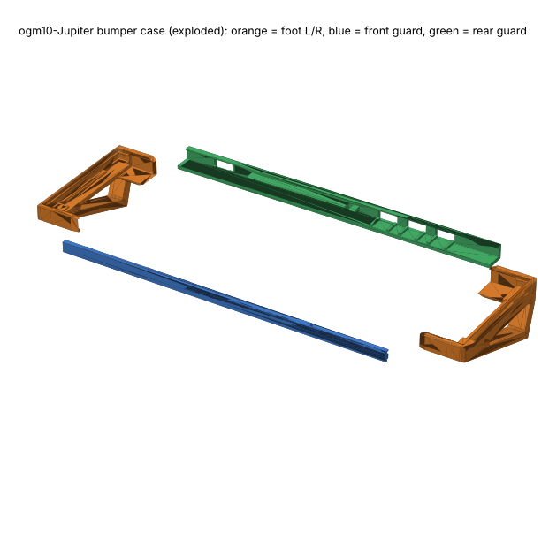
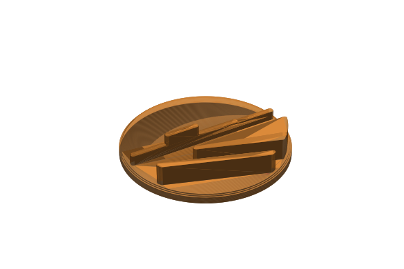

# バンパーケース

ogm10-Jupiter の基板とプレートの周りを囲んで保護する、3Dプリント用のケースです。左右の足（傾斜付き）と前後のガードの4パーツで、基板の側面をぐるっと覆います。ネジは使わず、パーツ同士とキーボードを挟み込んで固定します。

縦置き用のスタンドもあります。



## パーツ

| ファイル | 内容 | 数 |
|---|---|---|
| `ogm10-Jupiter-foot-L.stl` | 左の足。キーボードを奥が高くなるように約 19° 傾けます | 1 |
| `ogm10-Jupiter-foot-R.stl` | 右の足（左の鏡像） | 1 |
| `ogm10-Jupiter-guard-front.stl` | 手前のガード | 1 |
| `ogm10-Jupiter-guard-rear.stl` | 奥のガード（USB-C の開口付き） | 1 |
| `ogm10-Jupiter-stand.stl` | 縦置き用スタンド（直径 74mm） | 1（必要なら） |

STL は印刷する向きに置いてあります。前後のガードは長さ約 214mm あるので、ベッドに斜めに置いています。Bambu Lab A1 mini（180×180mm）で印刷できる大きさです。

## 取り付け方

1. 手前のガードを、基板の手前の縁にはめます。ガードの爪は、メイン基板とボトムプレートの間に差し込みます。
2. 奥のガードも同じように、奥の縁にはめます。USB-C の開口とコネクタの位置を合わせてください。
3. 左右の足を、キーボードの端から差し込みます。足の溝がボトムプレートの端をくわえ、足のカバー部分が前後のガードの端を外側と上から覆って固定します。

足をはめたら、前後のガードは足に挟まれて抜けなくなります。外すときは足から先に抜いてください。

## 各部の寸法

- 足が基板・ボトムプレートをくわえる部分のすき間：片側 0.15mm
- 足のカバーと前後のガードのすき間：0.1mm
- ガードの爪は、基板裏の部品（Choc ソケット、ダイオード、コンデンサ、スペーサーなど）から 0.4〜0.5mm 離しています。
- 奥のガードには、ボトムプレートの USB の切れ込みに入る突起があります。USB-C の左右には爪を付けていません。

## 縦置きスタンド



キーボードの左端を下にして、足をスタンドに差し込んで立てます。

- フィン側の壁と、足の肉抜き穴に入る三角の突起で、足の位置を決めます。
- キー側の細い段がトッププレートの上面に当たり、キー側に倒れるのを防ぎます。この段は、Shift とロータリーエンコーダーの位置だけ高さを変えています。
- Shift の位置で段を伸ばしているため、**左端専用**です。右端を下にすると差し込めません。
- 足の端に滑り止めを貼って使う前提で、キー側の低い壁はありません。
- 倒れ始める角度は計算上、キー側に約 20°、フィン側に約 15° です。

## 生成スクリプト

`scripts/` に、STL を作った Python スクリプトがあります（manifold3d、trimesh、shapely を使います）。

```
python3 gen_v31.py <出力フォルダ>       # 足 L/R・前ガード・後ガード
python3 gen_stand24.py <出力フォルダ>   # スタンド
```

すき間や爪の位置は、各スクリプトの先頭の定数で変えられます。
