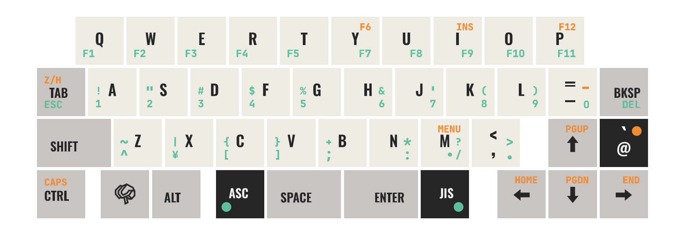

# キーキャップ（3Dプリント）

[← トップページに戻る](../README.md)

ogm10-Jupiter の 43キー分のキーキャップを3Dプリントで作れます。印字は天面から 0.6 mm の深さまで別の色で埋め込む方式なので、こすれて消えることはありません。



## 仕様

| 項目 | 内容 |
|---|---|
| 対応する軸 | MX 互換の十字軸（Kailh Choc V2 など） |
| サイズ | MX サイズ。1u は底面 18 × 18 mm、天面 16 × 16 mm。SHIFT・SPACE・ENTER は 1.5u（底面 27.5 mm） |
| 形 | 天面は平ら、側面は片側 1.0 mm 内側に傾く台形。高さ 4.6 mm |
| 十字穴 | 幅 1.20 mm × 長さ 4.05 mm、深さ 3.0 mm（軸の筒は直径 5.5 mm） |
| 印字 | 深さ 0.6 mm の埋め込み。メインの文字は Oswald、小さい文字は JetBrains Mono |
| ホームポジション | F と J の天面に高さ 0.5 mm の突起 |

## ファイル

キーの本体の色ごとに 3 枚に分かれています。2 色版とフルカラー版があります。

| ファイル | キー | 数 | 本体 |
|---|---|---|---|
| `ogm10-Jupiter-keycaps-cream-*.3mf` | Q〜P、A〜L、=/-、Z〜M、<, | 28 | クリーム |
| `ogm10-Jupiter-keycaps-gray-*.3mf` | TAB、BKSP、SHIFT、PGUP、CTRL、ロゴ、ALT、SPACE、ENTER、←↓→ | 12 | グレー |
| `ogm10-Jupiter-keycaps-dark-*.3mf` | @、ASC、JIS（● はレイヤー切り替えの目印） | 3 | 黒 |
| `ogm10-Jupiter-keycap-cross-fit-test.stl` | 十字穴のテストキー 5 個（下の「十字穴の合わせ込み」） | 5 | — |

| 種類 | 色 |
|---|---|
| `-2color` | 白と黒の 2 色。明るいキーは白の本体に黒の印字、黒のキーは黒の本体に白の印字 |
| `-fullcolor` | クリーム・グレー・黒の本体に、黒・白・緑・オレンジの印字。どのファイルも 4 色以内なので、4 スロットの AMS 1 台で刷れます |

フルカラー版の色と、近い Bambu PLA Matte の色の目安です。

| 色 | 値 | 目安 |
|---|---|---|
| クリーム | #EDEBE3 | Ivory White |
| グレー | #C9C3C1 | Bone White |
| 黒 | #262626 | Charcoal |
| 緑 | #5DBF9E | Grass Green |
| オレンジ | #F08C32 | Mandarin Orange |

Bambu Studio で開くと、色をフィラメントに割り当てる画面が出ます。表の色に合わせてスロットを選んでください。

## 印刷

天面を上にしたまま、サポートなしで刷れます。印字の線が細いので、0.2 mm ノズルを推奨します。

確認済みの設定（Bambu Lab P1S、0.2 mm ノズル、Bambu PLA Basic）：

| 項目 | 値 |
|---|---|
| 積層ピッチ | 0.08 mm（1 層目 0.1 mm） |
| 充填密度 | 100%（直線） |
| ブリッジ流量 | 0.85 |
| ブリッジ速度 | 25 mm/s |
| 外壁 / 内壁 / トップ面の速度 | 40 / 80 / 60 mm/s |
| ブリム | なし |
| アイロン | なし（印字がにじむため） |

- キーの内側の空洞の天井は宙に渡して刷るので、ブリッジ流量と速度を下げると裏面がきれいになります。
- 天面のざらつきが気になるときは、800 番程度の紙やすりで水研ぎするか、つや消しのクリアスプレーを薄く吹いてください。印字は 0.6 mm の深さまであるので、軽く研いでも消えません。十字穴にはスプレーがかからないようにしてください。

## 十字穴の合わせ込み

十字穴のはまり具合は、プリンター・ノズル・フィラメントで変わります。先に `ogm10-Jupiter-keycap-cross-fit-test.stl` を刷って、スイッチに挿してちょうどいいものを選んでください。天面に番号と穴の幅が彫ってあります。

| 番号 | 1 | 2 | 3 | 4 | 5 |
|---|---|---|---|---|---|
| 十字穴（幅 × 長さ mm） | 1.10 × 3.95 | 1.15 × 4.00 | 1.20 × 4.05 | 1.25 × 4.10 | 1.30 × 4.15 |

キーセットは 3 番の寸法で作ってあります（P1S・0.2 mm ノズル・PLA で、裏返しても落ちない程度の固さ）。別の番号が合う場合は、`scripts/gen_keycaps.py` の `CROSS_L, CROSS_W` を書き換えて作り直してください。

## データの作り直し

`scripts/` に生成スクリプトがあります。

```
pip install numpy trimesh manifold3d shapely matplotlib
python3 scripts/gen_keycaps.py .      # 3MF・テストキー・配置図を作る
python3 scripts/check_layout.py mx    # 文字がはみ出していないか、くっついていないかを確認
```

- 印字の内容・位置・大きさは `gen_keycaps.py` の `KEYS` で決めています。
- ロゴは `logo.png` の輪郭を直線の多角形に整えたもの（`LOGO_OUTER` / `LOGO_HOLES`）です。線は `LOGO_THICKEN` で太らせ、狭くなる余白は頂点を動かして印刷で潰れない幅に広げています。
- フォントは SIL Open Font License で配布されているものを同梱しています（`scripts/fonts/` のライセンス文を参照）。
