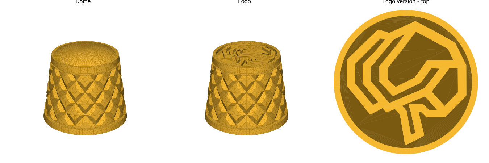
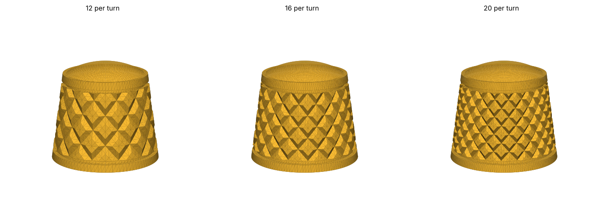
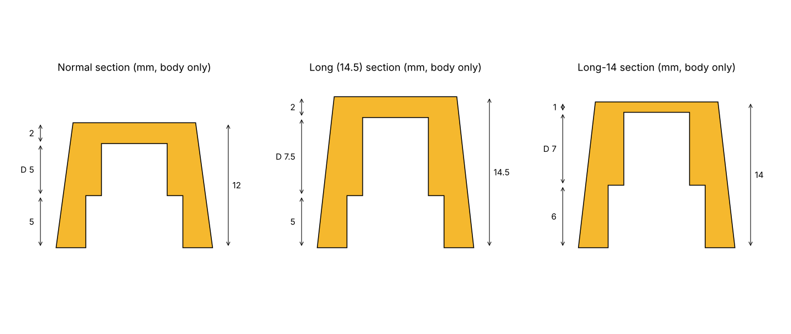

# ロータリーエンコーダー用ノブ

[← トップページに戻る](../README.md)

ENC1 / ENC2（EC11 / EC12、φ6 Dカット軸）用のノブを3Dプリントで作れます。データはこのフォルダにあります。

市販品であればuxcell ポテンショメータノブ　ASINコード「B07TJQB7FB」がおすすめです。

天面の形（2種）× 軸の長さ（3種）× 側面の網目（2種）の組み合わせで STL を用意しています。下の「選び方」で自分に合うファイルを選んでください。

## 選び方

### 1. 天面の形

| 種類 | 内容 |
|---|---|
| ドーム版（`dome`） | 天面が球面にふくらむ |
| ロゴ版（`logo`） | 天面のくぼみにイラストを浮き出し |

### 2. 軸の長さ（エンコーダーに合わせる）

EC11 / EC12 には、軸のDカット部分（平らに削られた部分）の長さが違う製品があります。手持ちのエンコーダーのDカット部分を測って選んでください。

| Dカット部分の長さ | 使うノブ | 断面（下から 底の穴 / Dカット穴 / 天井） | 胴体の高さ |
|---|---|---|---|
| 約5 mm | 通常版（ファイル名に `long` なし） | 5 / 5 / 2 mm | 12 mm |
| 約7.5 mm（通常より2.5 mm長い） | ロング（`long`） | 5 / 7.5 / 2 mm | 14.5 mm |
| 約7 mm | ロング14（`long14`） | 6 / 7 / 1 mm | 14 mm |

### 3. 側面の網目（ノズル径に合わせる）

| ノズル径 | 網目 | ファイル名 |
|---|---|---|
| 0.4 mm | 一周12山（網目の横幅 底で約3.9 mm） | 末尾に `fine` なし |
| 0.2 mm | 一周20山（網目の横幅 底で約2.4 mm） | 末尾が `-fine` |

## ファイル一覧

| | 0.4 mm ノズル（12山） | 0.2 mm ノズル（20山） |
|---|---|---|
| ドーム版・通常 | `ogm10-Jupiter-knob-dome.stl` | `ogm10-Jupiter-knob-dome-fine.stl` |
| ロゴ版・通常 | `ogm10-Jupiter-knob-logo.stl` | `ogm10-Jupiter-knob-logo-fine.stl` |
| ドーム版・ロング | `ogm10-Jupiter-knob-dome-long.stl` | `ogm10-Jupiter-knob-dome-long-fine.stl` |
| ロゴ版・ロング | `ogm10-Jupiter-knob-logo-long.stl` | `ogm10-Jupiter-knob-logo-long-fine.stl` |
| ドーム版・ロング14 | `ogm10-Jupiter-knob-dome-long14.stl` | `ogm10-Jupiter-knob-dome-long14-fine.stl` |
| ロゴ版・ロング14 | `ogm10-Jupiter-knob-logo-long14.stl` | `ogm10-Jupiter-knob-logo-long14-fine.stl` |

ほかに、`ogm10-Jupiter-knob-fit-test.stl`（はめあい確認用リング 3種、全バージョン共通）と、寸法を変えて作り直すための FreeCAD マクロ（`*.FCMacro`）があります。マクロは12山の設定になっているので、20山にする場合は `KNURL_COUNT` を `20` に変えて実行してください。

## 主な寸法

| 項目 | 寸法 |
|---|---|
| 外径 | 底 φ15 mm → 上端 φ11.75 mm（テーパー、全バージョン共通） |
| 全高 | 通常版: ドーム版 約13.5 mm / ロゴ版 12 mm ロング: ドーム版 約16 mm / ロゴ版 14.5 mm ロング14: ドーム版 約15.5 mm / ロゴ版 14 mm |
| 側面 | 先端を平らにカットしたアヤメローレット（一周12山 または 20山、溝深さ0.4 mm）、上下に1 mmの平らな帯と切れ込み |
| 軸穴 | φ6 Dカット（D幅4.5 mm）、片側すき間0.15 mm + 圧入リブ3本（高さ0.25 mm）、深さは上の表のとおり |
| 底の穴 | φ9.3 mm（エンコーダー本体の逃げ）、深さは上の表のとおり |

## 断面図

断面図の見方（下から順に）:

- **底の穴（5 / 5 / 6 mm）**: エンコーダー本体の上部が入る逃げ穴です。
- **Dカット穴（D 5 / D 7.5 / D 7 mm）**: 軸のDカット部分が入る穴です。エンコーダーのDカット部分の長さに合わせて深さを変えています。
- **天井（2 / 2 / 1 mm）**: 穴の上に残す厚みです。
- **全高（12 / 14.5 / 14 mm）**: 胴体の高さです。ドーム版はこの上にドームが乗ります。

天面の直径（φ11.75 mm）はどのバージョンも同じなので、ロゴの大きさと線幅は変わりません。胴体が高いバージョンほど側面の傾斜は少しゆるやかになります（通常版 約7.7° / ロング14 約6.6° / ロング 約6.4°）。軸穴の形は共通なので、はめあい確認用リングはどのバージョンにも使えます。

## 印刷のコツ

- 天面を上にして（底の穴を下にして）そのまま印刷できます。
- 軸穴のきつさはプリンターごとに差が出るので、先に `ogm10-Jupiter-knob-fit-test.stl` を印刷して確認するのがおすすめです。高さ 4 / 5 / 6 mm のリングがリブ高さ 0.15 / 0.25 / 0.35 mm に対応し、STL のノブは 5 mm のリングと同じ（0.25 mm）です。
- ゆるい・きつい場合は、マクロの `RIB_HEIGHT` を合ったリングの値に変えて FreeCAD で実行し、メッシュを STL に書き出してください。
- ロゴ版のイラストの線幅は約0.6 mm です。0.4 mm ノズルでも印刷できますが、0.2 mm ノズルのほうが線がくっきり出ます。
- 0.2 mm ノズルなら、20山の細かい網目もきれいに出ます。網目が浅く感じる場合は、マクロの `KNURL_DEPTH` を 0.4 → 0.5 mm にすると溝がはっきりします。
- ロング14のロゴ版は、天井1 mmに天面のくぼみ0.5 mmがあるため、軸穴の真上の厚みが0.5 mmしかありません。軸は強く押し込みすぎないようにしてください。
